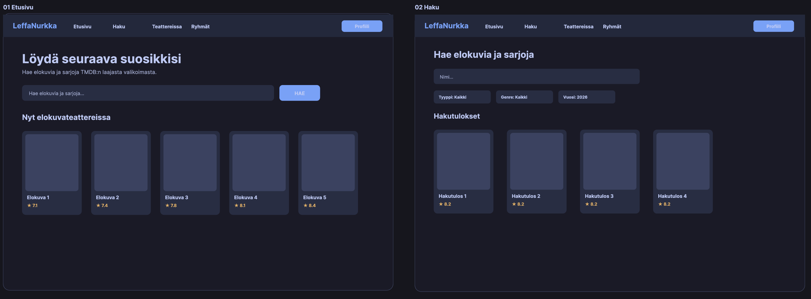
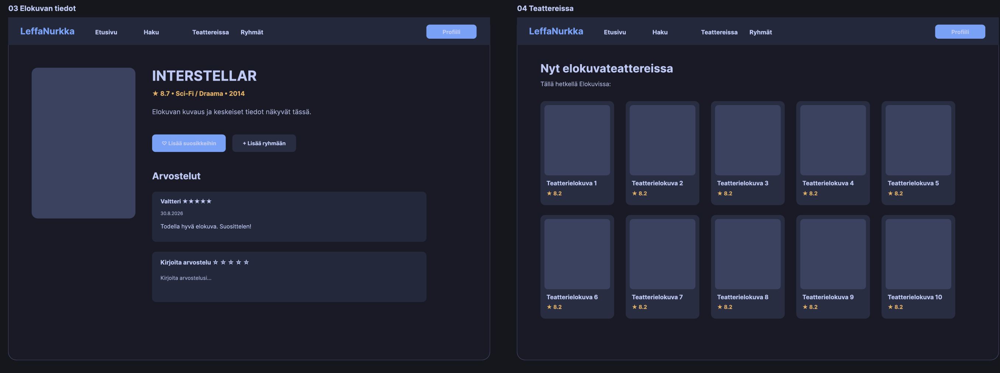
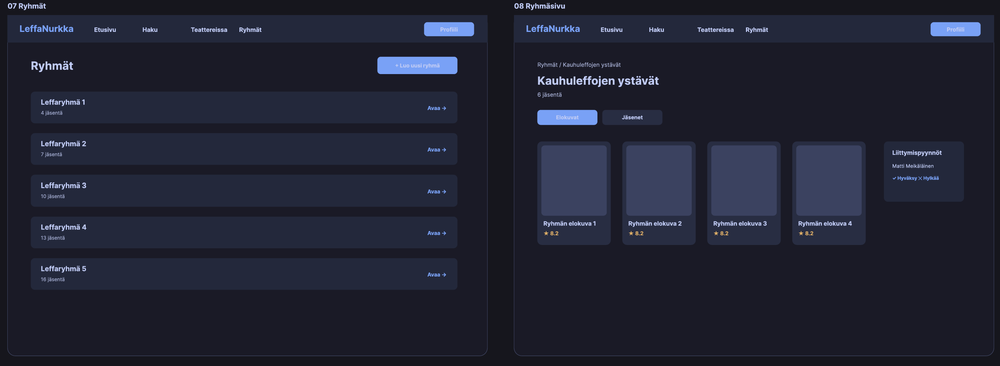
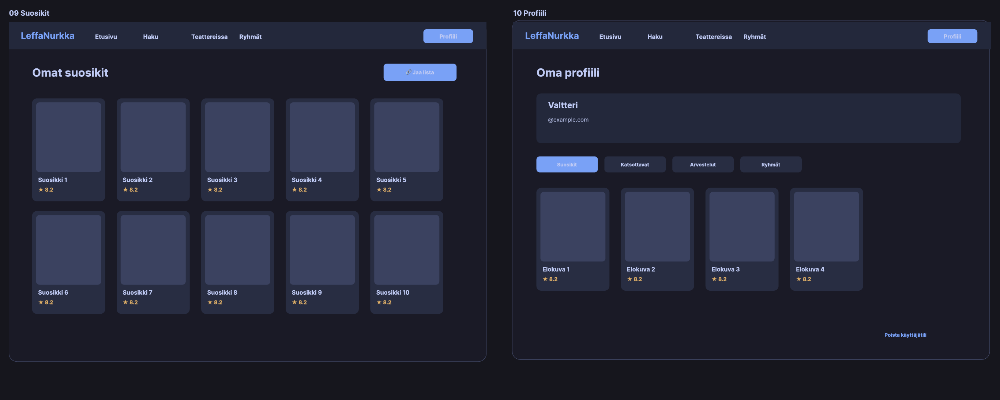

# Movie App — Full-Stack Web Application

A full-stack movie application built with React, Node.js/Express, and PostgreSQL, containerized using Docker Compose. The application integrates with The Movie Database (TMDB) API to allow users to search for movies, manage personal watchlists and favorites, write reviews, and collaborate in custom movie groups.

```text
Browser
   │
   ▼
Frontend :5173
   │
   ▼
Backend :3000
   │
   ▼
PostgreSQL :5432
```

---

## Tech Stack

- **Frontend:** React, Vite
- **Backend:** Node.js, Express, JWT Authentication
- **Database:** PostgreSQL
- **Containerization:** Docker Compose
- **Testing:** Vitest, Supertest

---

## Prerequisites

- [Docker Desktop](https://www.docker.com/products/docker-desktop/) installed and running
- Git

---

## Getting Started

### 1. Clone the repository

```bash
git clone https://github.com/group8-movieapp/movie-app.git
cd movie-app
```

### 2. Configure Environment Variables

Create your local `.env` configuration file from the provided template:

```bash
# Windows PowerShell
Copy-Item .env.example .env

# Linux / macOS / Git Bash
cp .env.example .env
```

> **Note:** Fill in your required secrets in `.env` (such as `JWT_SECRET` and your `TMDB_API_KEY`).

### 3. Start the Application

Build and run all services with Docker Compose:

```bash
docker compose up --build
```

Once all containers are healthy, access the services:

- **Frontend:** [http://localhost:5173](http://localhost:5173)
- **Backend API:** [http://localhost:3000](http://localhost:3000)

---

## Running Automated Tests

The backend test suite is executed in the containerized environment against an isolated test database:

```bash
npm test
```

Or directly via Docker Compose:

```bash
docker compose exec backend npm test
```

The test suite covers:

- **Authentication & User Management:** Registration, login, logout, account deletion.
- **Reviews:** Public review browsing, adding authenticated reviews, owner-only deletion.
- **Movies & API:** TMDB integration and endpoint error handling.

---

## Stopping the Application

Stop all running containers:

```bash
docker compose down
```

To stop containers and reset database volumes completely:

```bash
docker compose down -v
```
## UI Design 






## REST API Documentation

The backend provides the following REST API endpoints:

### 1. Users & Authentication
| Method | Endpoint | Description | Authentication Required |
| :--- | :--- | :--- | :--- |
| `POST` | `/api/users/signup` | Register a new user | No |
| `POST` | `/api/users/login` | Log in user | No |
| `POST` | `/api/users/logout` | Log out user | Yes |
| `DELETE` | `/api/users` | Delete user account | Yes |

### 2. Movies (TMDB Integration)
| Method | Endpoint | Description | Authentication Required |
| :--- | :--- | :--- | :--- |
| `GET` | `/api/movies/search` | Search for movies by keyword | No |
| `GET` | `/api/movies/now-playing` | Get movies currently in theaters | No |
| `GET` | `/api/movies/discover` | Discover / filter movies | No |
| `GET` | `/api/movies/:id` | Get detailed information for a single movie | No |

### 3. Favorites
| Method | Endpoint | Description | Authentication Required |
| :--- | :--- | :--- | :--- |
| `GET` | `/api/favorites` | Get authenticated user's favorite movies | Yes |
| `POST` | `/api/favorites` | Add a movie to favorites | Yes |
| `DELETE` | `/api/favorites/:movieId` | Remove a movie from favorites | Yes |

### 4. Watchlist
| Method | Endpoint | Description | Authentication Required |
| :--- | :--- | :--- | :--- |
| `GET` | `/api/watchlist` | Get authenticated user's watchlist | Yes |
| `POST` | `/api/watchlist` | Add a movie to the watchlist | Yes |
| `DELETE` | `/api/watchlist/:movieId` | Remove a movie from the watchlist | Yes |

### 5. Reviews
| Method | Endpoint | Description | Authentication Required |
| :--- | :--- | :--- | :--- |
| `GET` | `/api/reviews` | Get all reviews | No |
| `GET` | `/api/reviews/movie/:movie_id` | Get reviews for a specific movie | No |
| `POST` | `/api/reviews` | Create a new movie review | Yes |
| `DELETE` | `/api/reviews/:id` | Delete a review by ID | Yes |

### 6. Groups
| Method | Endpoint | Description | Authentication Required |
| :--- | :--- | :--- | :--- |
| `GET` | `/api/groups` | Get all groups | No |
| `GET` | `/api/groups/mine` | Get authenticated user's groups | Yes |
| `POST` | `/api/groups` | Create a new group | Yes |
| `GET` | `/api/groups/:id` | Get specific group details | Yes |
| `DELETE` | `/api/groups/:id` | Delete a group | Yes |
| **Members & Requests** | | | |
| `GET` | `/api/groups/:id/members` | Get group members | Yes |
| `POST` | `/api/groups/:id/join` | Send a join request to a group | Yes |
| `GET` | `/api/groups/:id/requests` | Get group join requests | Yes |
| `POST` | `/api/groups/:id/requests/:userId/accept` | Accept a join request | Yes |
| `DELETE` | `/api/groups/:id/requests/:userId` | Reject / remove a join request | Yes |
| `DELETE` | `/api/groups/:id/members/:userId` | Remove a member / leave group | Yes |
| **Group Movies** | | | |
| `GET` | `/api/groups/:id/movies` | Get movies added to the group | Yes |
| `POST` | `/api/groups/:id/movies` | Add a movie to the group list | Yes |
| `DELETE` | `/api/groups/:id/movies/:movieId` | Remove a movie from the group list | Yes |


